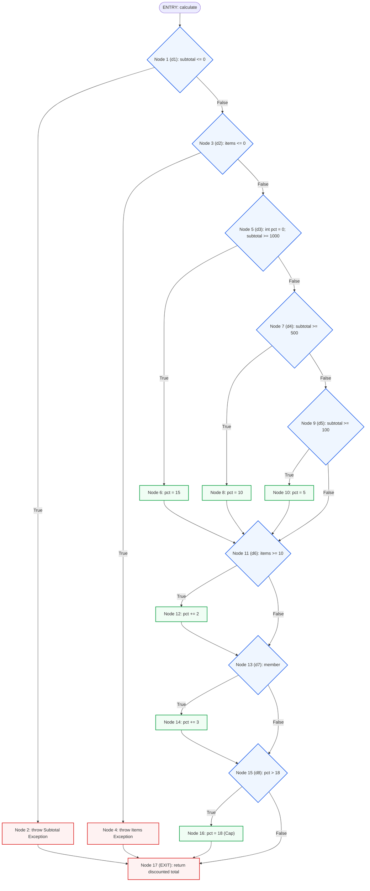

# Control Flow Graph (CFG) Analysis

## 1. Selected White-Box Module: DiscountCalculator.java

The selected white-box component for structural coverage and graph analysis is `com.qa.logic.DiscountCalculator`. This module computes e-commerce and subscription pricing tiers with volume and membership loyalty discounts, featuring complex predicate nesting and edge conditions.

### Complete Source Code:
```java
package com.qa.logic;

/** White-box target: checkout discount. 8 predicate nodes -> V(G) = 9. */
public class DiscountCalculator {
    public static double calculate(double subtotal, int items, boolean member) {
        if (subtotal <= 0) throw new IllegalArgumentException("Subtotal must be > 0");   // d1 (Node 1)
        if (items <= 0) throw new IllegalArgumentException("Items must be > 0");         // d2 (Node 3)
        int pct = 0;                                                                     // (Node 5)
        if (subtotal >= 1000) pct = 15;                                                  // d3 (Node 5)
        else if (subtotal >= 500) pct = 10;                                              // d4 (Node 7)
        else if (subtotal >= 100) pct = 5;                                               // d5 (Node 9)
        if (items >= 10) pct += 2;                                                       // d6 (Node 11)
        if (member) pct += 3;                                                            // d7 (Node 13)
        if (pct > 18) pct = 18;                                                          // d8 (Node 15)
        return Math.round(subtotal * (100 - pct)) / 100.0;                              // (Node 17)
    }
}
```

---

## 2. Node Identification and Basic Blocks

The code is formally partitioned into 17 Basic Block nodes ($N = 17$), with decision nodes designated as diamonds and processing/exit nodes as rectangles:

| Node ID | Node Type | Syntax Shape in Mermaid | Code / Description | Out-degree | Outgoing Target Nodes |
|:---:|:---:|:---:|:---|:---:|:---|
| **Node 1** | Decision ($d_1$) | Diamond `{...}` | `subtotal <= 0` | 2 | Node 2 (True), Node 3 (False) |
| **Node 2** | Process / Exit | Rectangle `[...]` | `throw new IllegalArgumentException("Subtotal must be > 0")` | 1 | Node 17 (Unified Exit) |
| **Node 3** | Decision ($d_2$) | Diamond `{...}` | `items <= 0` | 2 | Node 4 (True), Node 5 (False) |
| **Node 4** | Process / Exit | Rectangle `[...]` | `throw new IllegalArgumentException("Items must be > 0")` | 1 | Node 17 (Unified Exit) |
| **Node 5** | Decision ($d_3$) | Diamond `{...}` | `int pct = 0; subtotal >= 1000` | 2 | Node 6 (True), Node 7 (False) |
| **Node 6** | Process | Rectangle `[...]` | `pct = 15` | 1 | Node 11 |
| **Node 7** | Decision ($d_4$) | Diamond `{...}` | `subtotal >= 500` | 2 | Node 8 (True), Node 9 (False) |
| **Node 8** | Process | Rectangle `[...]` | `pct = 10` | 1 | Node 11 |
| **Node 9** | Decision ($d_5$) | Diamond `{...}` | `subtotal >= 100` | 2 | Node 10 (True), Node 11 (False) |
| **Node 10** | Process | Rectangle `[...]` | `pct = 5` | 1 | Node 11 |
| **Node 11** | Decision ($d_6$) | Diamond `{...}` | `items >= 10` | 2 | Node 12 (True), Node 13 (False) |
| **Node 12** | Process | Rectangle `[...]` | `pct += 2` | 1 | Node 13 |
| **Node 13** | Decision ($d_7$) | Diamond `{...}` | `member == true` | 2 | Node 14 (True), Node 15 (False) |
| **Node 14** | Process | Rectangle `[...]` | `pct += 3` | 1 | Node 15 |
| **Node 15** | Decision ($d_8$) | Diamond `{...}` | `pct > 18` | 2 | Node 16 (True), Node 17 (False) |
| **Node 16** | Process | Rectangle `[...]` | `pct = 18` (discount cap) | 1 | Node 17 |
| **Node 17** | Exit | Rectangle `[...]` | `return Math.round(subtotal * (100 - pct)) / 100.0` | 0 | Terminal Node |

---

## 3. Control Flow Graph (Mermaid Diagram)



---

## 4. Directed Edge Listing
The graph possesses exactly 24 directed edges ($E = 24$):
1. `(Node 1 -> Node 2)` [True branch $d_1$]
2. `(Node 1 -> Node 3)` [False branch $d_1$]
3. `(Node 2 -> Node 17)` [Exception Exit]
4. `(Node 3 -> Node 4)` [True branch $d_2$]
5. `(Node 3 -> Node 5)` [False branch $d_2$]
6. `(Node 4 -> Node 17)` [Exception Exit]
7. `(Node 5 -> Node 6)` [True branch $d_3$]
8. `(Node 5 -> Node 7)` [False branch $d_3$]
9. `(Node 6 -> Node 11)` [Merge into $d_6$]
10. `(Node 7 -> Node 8)` [True branch $d_4$]
11. `(Node 7 -> Node 9)` [False branch $d_4$]
12. `(Node 8 -> Node 11)` [Merge into $d_6$]
13. `(Node 9 -> Node 10)` [True branch $d_5$]
14. `(Node 9 -> Node 11)` [False branch $d_5$]
15. `(Node 10 -> Node 11)` [Merge into $d_6$]
16. `(Node 11 -> Node 12)` [True branch $d_6$]
17. `(Node 11 -> Node 13)` [False branch $d_6$]
18. `(Node 12 -> Node 13)` [Merge into $d_7$]
19. `(Node 13 -> Node 14)` [True branch $d_7$]
20. `(Node 13 -> Node 15)` [False branch $d_7$]
21. `(Node 14 -> Node 15)` [Merge into $d_8$]
22. `(Node 15 -> Node 16)` [True branch $d_8$]
23. `(Node 15 -> Node 17)` [False branch $d_8$]
24. `(Node 16 -> Node 17)` [Final Merge to Exit]
