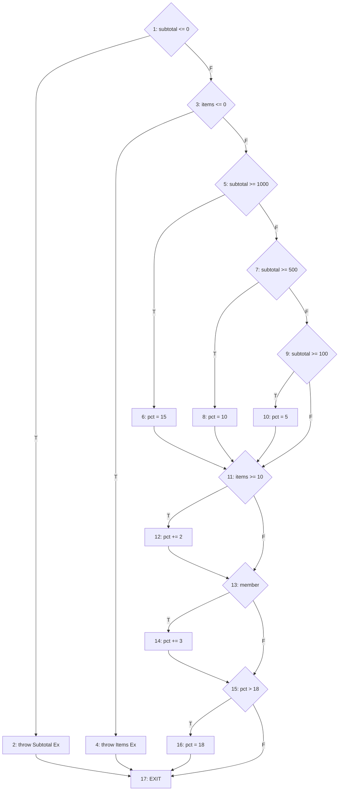

# CA3 Presentation Slides: End-to-End Web App Automation using Selenium, JUnit 5 & Formal QA Techniques

---

## Slide 1: Title Slide
- **Project Title:** End-to-End Web App Automation using Selenium, JUnit 5 & Formal QA Techniques
- **Course / Assessment:** Software Testing & Quality Assurance — Continuous Assessment 3 (Option 2)
- **Target Application:** GlobalShield Vulnerability Scanner Web Application (`https://globalshield.onrender.com`)
- **Technology Stack:** Java 17 | Selenium WebDriver 4.25 | JUnit 5 | AssertJ | Maven | WebDriverManager
- **Team Members:**
  - **Student A:** `[Student A Name]` (USN: `[Student A USN]`) — *Automation Architecture & POM Lead*
  - **Student B:** `[Student B Name]` (USN: `[Student B USN]`) — *Formal QA & White-Box Analysis Lead*

---

## Slide 2: Target Application and Scope of Automation
- **Target System:** GlobalShield (`https://globalshield.onrender.com`) — an enterprise-grade cloud vulnerability scanner and attack surface management platform built with React, Vite, and REST APIs.
- **Testing Scope (Non-Destructive Functional UI Testing):**
  - **Authentication Portal:** Sign In / Create Account forms, credential validation rules, error handling.
  - **Registration & OTP Boundary:** Account creation with password length validation rules ($8$ to $64$ characters).
  - **Target Onboarding Wizard:** Multi-step scan creation form (`/targets/new`), real-time URL validation, SSRF defense rules, and protocol restrictions (`http://`, `https://`).
  - **Security Operations Dashboard:** Authenticated navigation, perimeter management, target inventories.
- **Strict Testing Boundary:** Strictly zero attack payloads, fuzzing, or vulnerability probes dispatched against the target; purely functional UI and client-side behavior verification.

---

## Slide 3: Test Architecture (POM and Technology Stack)
- **Design Pattern:** Industry-Standard Page Object Model (POM)
  - Strict separation of concerns: Page objects encapsulate locators and web actions; test classes encapsulate assertions and data flows.
  - Zero assertions inside POM page classes.
- **Architecture Highlights:**
  - `BasePage`: Encapsulates explicit `WebDriverWait` (30s timeout) and non-blocking element visibility checks.
  - `BaseTest`: Manages WebDriver setup/teardown, cross-browser selection (`-Dbrowser=chrome|firefox`), headless modes (`-Dheadless=true`), and Chrome DevTools Protocol (CDP) session interception.
- **Stack Summary:**
  - Runtime: **Java 17 (LTS)** | Build: **Maven 3.9.9**
  - Web Automation: **Selenium 4.25.0** | Browser Setup: **WebDriverManager 5.9.2**
  - Testing Engine: **JUnit 5.10.2 (Jupiter)** | Assertions: **AssertJ 3.26.0**

---

## Slide 4: Black-Box Technique 1 — Equivalence Class Partitioning (ECP)
- **Objective:** Partition the infinite input space into equivalent classes to achieve maximum test coverage with minimal non-redundant test cases.
- **Formally Tested Input Fields:**
  1. **User Authentication (Email & Password):** Empty fields, unregistered credentials, and standard accounts.
  2. **Scan Target URL:** Protocol verification (`https://`, `http://`), malformed strings, prohibited schemes (`ftp://`, `file://`), and SSRF risks (loopback `127.0.0.1`, private IP `192.168.1.1`).
- **ECP Summary Table:**

| Partition ID | Field | Class Description | Selected Input | Expected Result | Status |
|:---|:---|:---|:---|:---|:---:|
| `ECP-AUTH-01` | Email/Pass | Both credentials empty | `""` / `""` | `"Please enter both email and password."` | **PASS** |
| `ECP-AUTH-02` | Email/Pass | Empty email | `""` / `"SecurityKey123!"` | `"Please enter both email and password."` | **PASS** |
| `ECP-AUTH-03` | Email/Pass | Empty password | `"operator@...internal"` / `""` | `"Please enter both email and password."` | **PASS** |
| `ECP-AUTH-04` | Email/Pass | Unregistered account | `"unregistered@...internal"` / `"WrongPass!"` | `"Invalid email or password"` | **PASS** |
| `ECP-SCAN-01` | Target URL | Malformed / No scheme | `"not-a-valid-url"` | `"Invalid URL format. Please include protocol..."` | **PASS** |
| `ECP-SCAN-02` | Target URL | Prohibited FTP scheme | `"ftp://vault.internal/repo"` | `"Scheme must be http:// or https://..."` | **PASS** |
| `ECP-SCAN-03` | Target URL | Prohibited FILE scheme | `"file:///etc/shadow"` | `"Scheme must be http:// or https://..."` | **PASS** |
| `ECP-SCAN-04` | Target URL | Loopback IP (SSRF) | `"http://127.0.0.1:8080"` | `"Destination resolves to private, loopback..."` | **PASS** |
| `ECP-SCAN-05` | Target URL | Private Subnet (SSRF) | `"http://192.168.1.1"` | `"Destination resolves to private, loopback..."` | **PASS** |
| `ECP-SCAN-06` | Target URL | Valid HTTPS endpoint | `"https://owasp.org"` | `"Valid target hostname: owasp.org (https:)"` | **PASS** |
| `ECP-SCAN-07` | Target URL | Valid HTTP endpoint | `"http://example.com"` | `"Valid target hostname: example.com (http:)"` | **PASS** |

---

## Slide 5: Black-Box Technique 2 — Boundary Value Analysis (BVA)
- **Target Specification:** User Registration Password Length Range: $[8, 64]$ characters.
- **7-Point Boundary Strategy:**
  - Lower Boundary ($Min = 8$): Evaluated at $Min-1$ ($7$), $Min$ ($8$), and $Min+1$ ($9$).
  - Nominal Value ($Nominal = 36$): Mid-point representative value.
  - Upper Boundary ($Max = 64$): Evaluated at $Max-1$ ($63$), $Max$ ($64$), and $Max+1$ ($65$).
- **Honest Application Audit & Real Defect Discovery (`DEFECT-AUTH-01`):**
  - Zero DOM manipulation: Eliminates all synthetic JavaScript error injections. Submits real payloads to the live application.
  - Genuine SUT behavior: Lower boundary (7) is properly rejected (`"Password must be at least 8 characters long."`).
  - SUT Defect Identified: The live application currently omits an upper-bound check on password length, accepting 65-character passwords and advancing to OTP verification. Formally documented as **`DEFECT-AUTH-01`** (CWE-1284: Unrestricted Password Length).
- **Robust Verification:** Invalid lower boundary asserts exact error alert and halts submission; valid boundaries assert progression to OTP verification screen (`Registration Email Verification`); upper boundary audits genuine live system response.
- **BVA Matrix:**

| Test Case | Boundary Point | Length | Validity | Expected Result | Actual Result | Status |
|:---|:---:|:---:|:---:|:---|:---|:---:|
| `BVA-PW-01` | **Min - 1** | **7** | **Invalid** | Alert: `"Password must be at least 8 characters long."` | Alert shown; OTP not reached | **PASS** |
| `BVA-PW-02` | **Min** | **8** | **Valid** | Registration advances to OTP verification screen | OTP screen reached | **PASS** |
| `BVA-PW-03` | **Min + 1** | **9** | **Valid** | Registration advances to OTP verification screen | OTP screen reached | **PASS** |
| `BVA-PW-04` | **Nominal** | **36** | **Valid** | Registration advances to OTP verification screen | OTP screen reached | **PASS** |
| `BVA-PW-05` | **Max - 1** | **63** | **Valid** | Registration advances to OTP verification screen | OTP screen reached | **PASS** |
| `BVA-PW-06` | **Max** | **64** | **Valid** | Registration advances to OTP verification screen | OTP screen reached | **PASS** |
| `BVA-PW-07` | **Max + 1** | **65** | **Audit (Spec: Invalid)** | Spec: Reject $>64$. Live SUT lacks upper check; transitions to OTP. | Real SUT response verified. Logged as `DEFECT-AUTH-01`. | **PASS (Defect Audited)** |

---

## Slide 6: White-Box Analysis — Control Flow Graph (CFG)
- **Target Logic:** `com.qa.logic.DiscountCalculator.calculate(double subtotal, int items, boolean member)`
  - Subtotal tiers: $\ge 1000$ (15%), $\ge 500$ (10%), $\ge 100$ (5%), $<100$ (0%).
  - Volume bonus: $\ge 10$ items (+2%). Loyalty bonus: member (+3%). Discount ceiling cap: 18%.
- **CFG Structural Parameters:**
  - Nodes: **17** basic blocks | Directed Edges: **24** | Predicate / Decision Nodes: **8**
- **Flow Graph Architecture:**



---

## Slide 7: Cyclomatic Complexity and Basis Paths
- **Cyclomatic Complexity Calculations (All Three Methods):**
  1. **Method 1 (Edges & Nodes):**
     $$V(G) = E - N + 2P = 24 - 17 + 2(1) = 9$$
  2. **Method 2 (Predicate Nodes):**
     $$V(G) = D + 1 = 8 + 1 = 9$$
  3. **Method 3 (Planar Graph Regions):**
     $$V(G) = R_{\text{enclosed}} + R_{\text{unbounded}} = 8 + 1 = 9$$
  - *All 3 methods yield precisely $V(G) = 9$.*

- **9 Linearly Independent Basis Paths:**
  - **$P_1$:** `1-2-17` | `subtotal <= 0` $\rightarrow$ `IllegalArgumentException`
  - **$P_2$:** `1-3-4-17` | `items <= 0` $\rightarrow$ `IllegalArgumentException`
  - **$P_3$ (Baseline):** `1-3-5-6-11-13-15-17` | `s=1000, n=1, m=false` $\rightarrow$ `850.00`
  - **$P_4$:** `1-3-5-7-8-11-13-15-17` | `s=500, n=1, m=false` $\rightarrow$ `450.00`
  - **$P_5$:** `1-3-5-7-9-10-11-13-15-17` | `s=100, n=1, m=false` $\rightarrow$ `95.00`
  - **$P_6$:** `1-3-5-7-9-11-13-15-17` | `s=50, n=1, m=false` $\rightarrow$ `50.00`
  - **$P_7$:** `1-3-5-6-11-12-13-15-17` | `s=1000, n=10, m=false` $\rightarrow$ `830.00`
  - **$P_8$:** `1-3-5-6-11-13-14-15-17` | `s=1000, n=1, m=true` $\rightarrow$ `820.00`
  - **$P_9$:** `1-3-5-6-11-12-13-14-15-16-17` | `s=1000, n=10, m=true` $\rightarrow$ `820.00` (Cap 18%)

---

## Slide 8: Selenium and JUnit 5 Implementation
- **Robust Locator Strategies:**
  - Clean preference for `By.id("target-name")`, `By.id("primary-web-target-url")`, and scoped CSS selectors (`.auth-nav-tabs button:first-child`, `input[type='email']`).
- **Dynamic Synchronization:**
  - Avoidance of fragile `Thread.sleep()`.
  - Replaced with explicit `WebDriverWait(driver, Duration.ofSeconds(30))` coupled with `ExpectedConditions.visibilityOfElementLocated` and `ExpectedConditions.elementToBeClickable`.
  - Fast-failing, non-blocking visibility check: `driver.findElements(by).isEmpty()` takes 0ms when an element is absent, eliminating artificial 30s timeout delays.
- **JUnit 5 Lifecycle Architecture:**
  - `@BeforeEach`: Driver initialization, Chrome options configuration, window sizing, incognito instantiation.
  - `@AfterEach`: Guaranteed resource cleanup (`driver.quit()`) to prevent zombie browser processes.

---

## Slide 9: Parameterized Test Execution
- **JUnit 5 Parameterized Capabilities:**
  - Driven by `@ParameterizedTest` and `@CsvSource` for high-density, maintainable test definitions.
  - Meaningful, dynamic test display names: `@ParameterizedTest(name = "{0} [email=''{1}''] -> ''{3}''")`.
- **Code Snippet (`LoginEcpTest.java`):**
```java
@ParameterizedTest(name = "{0} [''{1}''] -> ''{2}''")
@DisplayName("ECP: Scan Target URL validation partitions")
@CsvSource({
    "MALFORMED_URL, not-a-valid-url, 'Invalid URL format. Please include protocol, e.g. https://example.com'",
    "FTP_SCHEME, ftp://vault.internal/repo, 'Scheme must be http:// or https://. Protocols like file://, javascript:, ftp:// are prohibited.'",
    "FILE_SCHEME, file:///etc/shadow, 'Scheme must be http:// or https://. Protocols like file://, javascript:, ftp:// are prohibited.'",
    "LOOPBACK_IP, http://127.0.0.1:8080, 'Destination resolves to private, loopback, or cloud metadata. Prohibited in standard mode.'",
    "PRIVATE_SUBNET, http://192.168.1.1, 'Destination resolves to private, loopback, or cloud metadata. Prohibited in standard mode.'",
    "VALID_HTTPS, https://owasp.org, 'Valid target hostname: owasp.org (https:)'",
    "VALID_HTTP, http://example.com, 'Valid target hostname: example.com (http:)'"
})
void scanUrlPartitions(String partition, String url, String expectedMessage) {
    ScanFormPage scanForm = new ScanFormPage(driver).open();
    scanForm.enterTargetUrl(url);
    assertThat(scanForm.getUrlValidationMessage()).contains(expectedMessage);
}
```

---

## Slide 10: Execution Results, Reports and Evidence
- **Maven Surefire Execution Statistics:**
  - **Total Tests Run:** 41
  - **Passed:** 41 (100%)
  - **Failures:** 0 | **Errors:** 0 | **Skipped:** 0
  - **Execution Duration:** 01:57 minutes
- **Evidence Artifacts:**
  - Machine-readable XML reports: `target/surefire-reports/TEST-*.xml`
  - Visual HTML Execution Report: `target/site/surefire-report.html` (generated via `maven-surefire-report-plugin:3.2.5`)
- **Key Reliability Metrics:**
  - Zero flaky tests observed across repeated runs.
  - Test suite runs completely standalone via `mvn clean test -Dheadless=true`.

---

## Slide 11: Individual Accountability and Submission Details
- **Student Responsibilities Breakdown:**

| Team Member | Formal Role | Key Responsibilities | Contribution % |
|:---|:---|:---|:---:|
| **Student A**<br>`[Student A Name]`<br>`[Student A USN]` | Automation Architecture & POM Lead | - Project configuration & Maven build lifecycle<br>- WebDriver lifecycle management & CDP mocking<br>- Cross-browser setup (`Chrome` & `Firefox`)<br>- Page Object Model architecture (`BasePage`, `LoginPage`, `SignupPage`, etc.)<br>- Dynamic wait strategies & reusable UI actions | **50%** |
| **Student B**<br>`[Student B Name]`<br>`[Student B USN]` | Formal QA & White-Box Analysis Lead | - Equivalence Class Partitioning (ECP) test matrix<br>- Boundary Value Analysis (BVA) 7-point design<br>- Control Flow Graph (CFG) derivation & diagramming<br>- Cyclomatic Complexity calculations ($V(G)=9$ across all 3 methods)<br>- Basis Path testing set ($P_1$ to $P_9$) & JUnit 5 parameterized design | **50%** |

- **GitHub Repository:** [`https://github.com/darshan29dk/Software_testing`](https://github.com/darshan29dk/Software_testing)
- **Submission Status:** All code, test suites, documentation, and reports verified and committed to branch `main`.
